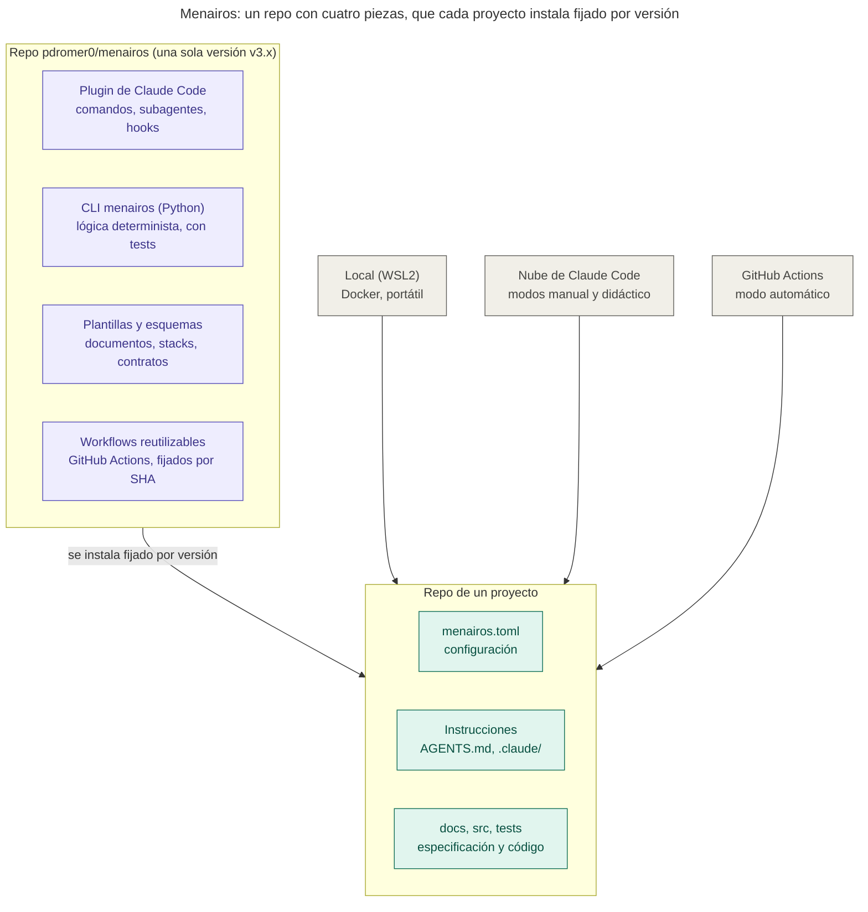

# Menairos — diseño

> **Estado:** v2 (2026-11-25), aceptado por Pedro. Las seis propuestas nuevas de este documento
> (marcadas **[aceptada]**) se aprobaron el 2026-11-25: plugin + CLI, GitHub por `gh api`,
> workflows reutilizables, esquemas, estado de los módulos en `menairos.toml` y stack de Menairos.
> El cómo. El qué y el porqué están en `producto.md`; las decisiones de fondo, en `decisiones/`
> (ADRs).

## 1. Arquitectura



- **Repo de Menairos:** cuatro piezas con una sola versión: el plugin (lo que necesita criterio),
  la CLI (lo determinista), las plantillas y esquemas (los contratos) y los workflows
  reutilizables (el modo automático).
- **Repo de cada proyecto:** instala Menairos fijado a la versión de `menairos.toml`; tiene sus
  instrucciones (`AGENTS.md`, `.claude/`), su especificación y su código.
- **Entornos de ejecución:** local para lo que necesita el portátil, la nube de Claude Code para
  los modos manual y didáctico, y GitHub Actions para el modo automático.

**Principio que lo ordena todo:** lo que requiere criterio lo hace un modelo (siguiendo un
prompt del plugin); todo lo demás lo hace la CLI determinista, con tests. Es una decisión de fondo
del método v2 («la lógica determinista en scripts con tests»), llevada al extremo para ahorrar
tokens.

## 2. Componentes

### 2.1 Plugin de Claude Code **[aceptada]**

| Pieza | Contenido |
| --- | --- |
| Comandos (skills) | `/crear-spec`, `/validar-spec`, `/preparar-entorno`, `/implementar`, `/cerrar-hito`, `/actualizar-menairos` |
| Subagentes | `revisor-spec`, `revisor-plan`, `revisor-pr`, `mutante` (versiones incorrectas), `inventario-mvp` (modo MVP de `/crear-spec`) |
| Hooks | `SessionStart` (rama, hito en curso, estado), `Stop` (N2 con sello), `PostToolUse` (formato), `PreToolUse` (anti-bucle) |

- Los prompts de los comandos son cortos y delegan en la CLI todo lo que se pueda calcular: el
  modelo recibe el resultado, no lo reconstruye.
- **Disponibilidad (verificada en T-04; decisión de Pedro, 2026-11-26):**
  - *Local:* basta con el `.claude/settings.json` del proyecto, que declara el marketplace de
    Menairos fijado a la versión de `menairos.toml` y habilita el plugin; carga tras aceptar la
    confianza en la carpeta.
  - *Nube de Claude Code:* el `.claude/settings.json` del repo no basta (las sesiones en la nube
    no instalan los plugins que declara). El script de entorno de la nube instala el plugin fijado
    a la versión del proyecto antes de que arranque Claude Code
    (`claude plugin marketplace add "pdromer0/menairos#<versión>"` y
    `claude plugin install menairos@menairos`); lo genera la capa nube de `menairos entorno` y
    Pedro lo pega en el entorno.
  - *GitHub Actions (`claude-code-action`):* pendiente de verificar en T-26.
  - *Plan B, probado como respaldo:* `/preparar-entorno` copia los ficheros del plugin a
    `.claude/` del proyecto (como hacía el método v2 con sus skills) y `/actualizar-menairos` los
    mantiene al día; se usaría si el script de entorno dejara de servir.
  - *Alternativa sin probar:* subir el plugin a la cuenta de claude.ai, cuyos plugins llegan a las
    sesiones en la nube (una sola versión para todos los proyectos, subida a mano).

### 2.2 CLI determinista `menairos` **[aceptada]**

Paquete Python en el mismo repo, con la misma versión que el plugin. Se instala fijado a la
versión del proyecto (`uv tool install` desde la etiqueta del repo) en local, en la nube y en
Actions.

| Orden | Para qué | Usado por |
| --- | --- | --- |
| `menairos spec validar` | Capa 1 de `/validar-spec`: esquemas, dependencias sin ciclos, enlaces a secciones, `abiertas.md`, ADRs de stack, validación funcional, plantilla del stack | `/validar-spec`, CI |
| `menairos spec publicar` | Milestone, issues, «blocked by», etiquetas, idempotente | `/validar-spec` (tras el OK) |
| `menairos contexto N` | Prepara el contexto de una tarea: issue, comentarios filtrados (solo Pedro y la App), secciones enlazadas de la especificación | `/implementar`, revisores |
| `menairos siguiente` | Elige la siguiente tarea (punto 13) | Orquestador |
| `menairos politica PR` | El check `politica` (punto 14) | Workflow de revisión |
| `menairos decisiones …` | Valida los ficheros de decisiones y agrega el resumen del hito | `/implementar`, `/cerrar-hito` |
| `menairos informe N` | Informe del hito: métricas, decisiones marcadas, validación funcional, disparadores | `/cerrar-hito` |
| `menairos cierre N --aprobar` | Los pasos deterministas del cierre (issues, ADRs, `menairos.toml`, etiqueta, Release) | `/cerrar-hito --aprobar` |
| `menairos consumo …` | Registra y agrega el consumo; presupuestos y pausa | Workflows, hooks |
| `menairos entorno [--comprobar]` | Las cuatro capas de `/preparar-entorno` | `/preparar-entorno` |
| `menairos migrar` | Migraciones entre versiones | `/actualizar-menairos` |

- **GitHub siempre por REST, a través de `gh api`** **[aceptada]**: reutiliza la autenticación
  que ya hay en cada entorno (local, nube, Actions con el token de la App) y evita GraphQL, que
  daba 403 en la nube.
- Salidas en JSON para que el modelo las lea sin interpretar texto libre, y en markdown cuando las
  lee Pedro.

### 2.3 Plantillas

```
plantillas/
├── docs/        producto, diseno, hitos, hito-N, hito-N.tareas.yaml, abiertas, adr, anexo,
│                decisiones-tarea.yaml, informe-hito, pull_request_template
├── agentes/     AGENTS.md, CLAUDE.md, .claude/settings.json por modo
├── stacks/
│   ├── base/        pre-commit, gitleaks, .gitignore, plantillas de issue, CI mínimo
│   └── python-uv/   pyproject (ruff, pytest, pyright, timeout), scripts N1–N3
└── extras/
    └── servicios/   compose.yaml, N3 de integración (módulo opcional)
```

Toda plantilla de stack cumple el **contrato común** (punto 11): las órdenes de lint, formato,
tipos y tests; `scripts/n1.sh`, `scripts/n2.sh`, `scripts/n3.sh`; pre-commit; el job de CI; los
permisos del agente; y la sección de comandos de `AGENTS.md`.

### 2.4 Workflows reutilizables **[aceptada]**

Los workflows viven en el repo de Menairos como *reusable workflows*; el proyecto solo tiene
ficheros finos que los llaman, fijados por SHA (punto 18). Así una mejora del orquestador llega
con `/actualizar-menairos` sin copiar YAML.

| Workflow | Disparo | Qué hace | Secretos |
| --- | --- | --- | --- |
| `ci` | PR, push a `main` | La N3 del contrato | **Ninguno** |
| `implementar` | Lo lanza el orquestador (`workflow_dispatch`) | Una sesión de `claude-code-action` para una tarea: plan, revisión del plan, implementación, PR | Token de Claude, App |
| `revisar` | PR de la App abierto o actualizado | Checks `revision` y `politica` | Token de Claude, App |
| `orquestador` | PR fusionado; etiqueta `necesita-pedro` quitada | `menairos siguiente` y lanza `implementar` | App |
| `repaso` | Programado (cada 3 h por defecto) | Sesiones colgadas, CI atascado, presupuestos | App |
| `cerrar` | Último issue del hito cerrado | Abre la tarea de cierre | App |

Todos comprueban primero `MENAIROS_PAUSA` y el autor del evento (solo `pdromer0` o la App),
llevan `timeout-minutes` y un grupo de concurrencia por issue.

### 2.5 Esquemas **[aceptada]**

JSON Schema versionados para `menairos.toml`, `hito-N.tareas.yaml` y los ficheros de decisiones.
Los usa `menairos spec validar` y sirven de documentación del contrato: un cambio de esquema que
rompa la compatibilidad es una versión mayor (punto 19).

## 3. Contratos

### 3.1 `menairos.toml` (ejemplo)

```toml
[menairos]
version = "3.0.0"

[proyecto]
nombre = "ejemplo"
repo = "pdromer0/ejemplo"
visibilidad = "publico"          # publico | privado (automático en privado: GitHub Pro)
idioma_docs = "es"
idioma_codigo = "en"

[stack]
plantillas = ["base", "python-uv"]

[modo]
defecto = "manual"               # manual | didactico | automatico
resumen_aprendizaje = true

[entornos]                       # entornos por defecto, no una restricción
manual = "nube"                  # nube | local
didactico = "nube"
automatico = "actions"           # actions | tareas-programadas

[modelos]
crear_spec = "opus"
plan = { normal = "sonnet", critica = "opus" }
implementacion = { normal = "sonnet", critica = "opus" }
revisor_plan = "opus"
revisor_pr = "opus"
informe = "sonnet"

[revisores]
spec = "codex"                   # codex | claude
pr = "claude"
segunda_opinion_critica = "codex"

[autonomia]
paralelismo = 1
criticas_pasan_por_pedro = true
dependencias_nuevas_pasan_por_pedro = true
rutas_protegidas = [".github/workflows/", ".claude/", "AGENTS.md", "menairos.toml"]

[escalado]
rondas_plan = 2
rondas_pr = 2
fallos_seguidos = 2
recordatorio_horas = 24

[guardarrailes]
modo_observacion = true          # el primer hito automático: los suaves solo registran
anti_bucle_repeticiones = 3
sesiones_por_tarea = 8
sesiones_dia = 15
aviso_presupuesto_pct = 80
ventana_horaria = ""             # p. ej. "22:00-07:00"; vacío = sin ventana
repaso_horas = 3

[guardarrailes.max_turnos]
plan = 25
implementacion = 100
revision = 20

[guardarrailes.timeout_min]
plan = 20
implementacion = 90
revision = 20

[modulos]                        # inactivo | piloto | activo | retirado
revisor_plan = "activo"
mutante = "inactivo"
orquestador = "inactivo"
auto_merge = "inactivo"
```

- **El estado de los módulos vive aquí** **[aceptada]**, legible por los scripts; la tabla
  humana de módulos (con disparadores y fechas) la genera la CLI en `docs/proceso/modulos.md`.
- Los valores numéricos son de partida: el primer hito automático los calibra.

### 3.2 `hito-N.tareas.yaml` (ejemplo)

```yaml
hito: 1
titulo: "Hito 1 — …"
tareas:
  - id: T-01
    titulo: "Modelo de datos de …"
    rama: feat/h1-modelo
    depende_de: []
    area: nucleo
    critica: false
    donde: cualquiera            # cualquiera | local
    quien: claude                # claude | codex (codex: solo en modo manual)
    modo: null                   # null = el del hito; o manual | didactico | automatico
    especificacion: ["hito-1.md#modelo-de-datos"]
    criterios_aceptacion:
      - "Dado …, cuando …, entonces …"
      - "Los tests de tests/test_modelo.py cubren los casos límite de la sección …"
  - id: T-02
    titulo: "…"
    depende_de: [T-01]
    critica: true
    motivo_critica: "Decide el esquema de datos público"
    # …
```

### 3.3 Fichero de decisiones de una tarea

El del punto 9 (`docs/specs/hito-N/decisiones/T-xx.yaml`): id, decisión, alternativas, motivo,
reversibilidad, impacto, por qué no escaló, agente, revisor, marcada y estado de la revisión.

### 3.4 Etiquetas de GitHub

| Etiqueta | Quién la pone | Para qué |
| --- | --- | --- |
| `tipo:tarea`, `tipo:bug`, `tipo:idea` | Script de publicación / Pedro | Clase de issue |
| `critica` | Script de publicación | Revisor del plan, política de fusión |
| `modo:manual`, `modo:didactico`, `modo:automatico` | Script / Pedro | Cambia el modo de una tarea |
| `en-curso` | Orquestador / `/implementar` | Idempotencia |
| `necesita-pedro` | Agente | Escalado; quitarla relanza |
| `aprobado-pedro` | Pedro | Desbloquea el check `politica` |
| `area:*` | Script de publicación | Paralelismo |

## 4. Flujos

| Comando | Lo hace el modelo | Lo hace la CLI |
| --- | --- | --- |
| `/crear-spec` | La conversación por fases, las opciones de stack y coste, la redacción | Plantillas, guardado por fases, comprobación de formato al cerrar cada fase |
| `/validar-spec` | Capa 2 (revisor con contexto limpio) | Capa 1, publicación |
| `/preparar-entorno` | Solo lo que se sale de la plantilla | Las cuatro capas y `--comprobar` |
| `/implementar` | Plan, implementación, revisión propia, PR | Contexto, N1–N3, validación del fichero de decisiones |
| `/cerrar-hito` | Resumen de aprendizaje y redacción del informe | Métricas, agregación, cierre con `--aprobar` |
| `/actualizar-menairos` | Solo los conflictos de una migración | Migraciones |

## 5. Stack de Menairos **[aceptada]**

- **Python 3.14 con uv**, ruff, pytest (con timeout), pyright y pre-commit con gitleaks: el stack
  ya probado con el método v2, que es la primera plantilla que Menairos ofrece (se come su propia
  comida).
- Bash solo para los hooks y los envoltorios mínimos; la lógica, en Python con tests.
- Dependencias mínimas: lectura de TOML de la biblioteca estándar, un validador de JSON Schema y
  un lector de YAML. Todo lo de GitHub, por `gh api`.

## 6. Calidad de Menairos

- **Niveles de tests N1–N3**, como en el método v2: N1 por commit (ruff, pyright, tests del área),
  N2 al final de cada turno (rápida con sello), N3 antes del push.
- **Dobles de GitHub con tope** (`RunawayLoop`): ningún test llama a GitHub de verdad.
- **Proyecto de prueba** para los tests de punta a punta de los comandos: un repo público de
  usar y tirar donde se ejercitan `/preparar-entorno`, `/validar-spec` y el orquestador.
- Las **comprobaciones deliberadas** del punto 11 forman parte de la N3 de la plantilla.

## 7. Coste

- Infraestructura: **0 €**. Repos públicos, minutos de Actions gratis, sin servicios externos.
- Modelos: las suscripciones que ya existen (Claude Max y Codex Pro), sin API keys de pago por
  uso. El control de cuota es el del punto 17.
- Único coste condicional: GitHub Pro, solo si un proyecto privado va en modo automático.

## 8. Riesgos

| Riesgo | Mitigación |
| --- | --- |
| El plugin no llega a la nube o a Actions | En la nube lo instala el script de entorno (verificado en T-04); en Actions, por verificar (T-26); plan B probado como respaldo (2.1) |
| El token OAuth de Max no sirve para sesiones largas en Actions | Verificar en el hito 0; si no, el modo automático corre en tareas programadas de Claude Code o en local |
| La revisión de Codex no se puede convertir en check | Claude como revisor bloqueante; Codex como segunda opinión |
| Las funciones en vista previa cambian (tareas programadas, Agent Teams) | No son la opción por defecto; quedan como alternativas configurables |
| El método crece demasiado antes de tiempo | El sistema de módulos: cada pieza entra con su disparador |

## 9. ADRs

Al crear el repo se convirtieron en ADRs (`decisiones/`) las decisiones de fondo del diseño del
método (puntos 7 a 19) y las seis de este documento aceptadas por Pedro el 2026-11-25: la
separación plugin + CLI, GitHub por `gh api`, los workflows reutilizables, los esquemas, el estado
de los módulos en `menairos.toml` y el stack de Menairos. El índice de `decisiones/README.md`
relaciona cada punto con su ADR.
