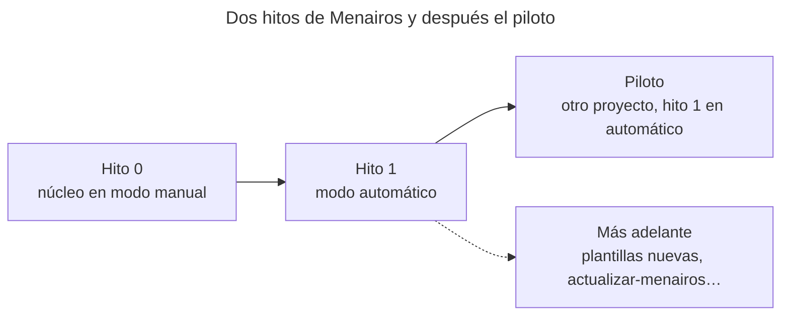

# Menairos — hitos

> **Estado:** v1 (2026-11-25), estructura aceptada por Pedro.
> La hoja de ruta. Solo el hito 0 se detalla en `specs/hito-0.md`; los demás se especifican al
> cerrar el anterior (punto 8 del diseño del método, ADR 0003).

## Vista general

| Hito | Objetivo | Casos de uso | Modo de trabajo |
| --- | --- | --- | --- |
| **H0** | Menairos sustituye al método v2 en un proyecto nuevo | CU-01 a CU-06, CU-10 básico, CU-13 | Manual: primero con el flujo del método v2, después con el propio `/implementar` |
| **H1** | Un hito de un proyecto se construye sin intervención salvo escalados | CU-07 a CU-09, CU-10 completo | Manual con `/implementar` (el modo automático aún no existe) |
| Más adelante | Lo que no hace falta hasta que se use | CU-11, CU-12 y alternativas | Según el disparador de cada módulo |

## Hito 0 — Núcleo en modo manual

**Objetivo.** Con H0 terminado, un proyecto nuevo se especifica, se prepara y se implementa en
modo manual o didáctico con Menairos, sin copiar nada a mano del método v2.

**Arranque.** Mientras `/implementar` no exista, las tareas se hacen con el flujo del método v2
(`tarea.md`, plan aprobado por Pedro, N1–N3, PR); el detalle, en §0 de `specs/hito-0.md`. En
cuanto `/implementar` funcione (tramo H0.4), el resto del hito se hace con el propio Menairos: es
la primera prueba real.

### Tramos

| Tramo | Contenido | Casos de uso | Depende de |
| --- | --- | --- | --- |
| **H0.0 Arranque** | Crear `pdromer0/menairos` (público, ruleset, CI con el stack ya probado con el método v2); meter los documentos de la especificación; convertir las decisiones de fondo del diseño del método y de `diseno.md` en ADRs; `menairos.toml` del propio repo | — | — |
| **H0.1 Contratos** | Esquemas JSON de `menairos.toml`, del YAML de tareas y de las decisiones; `menairos spec validar` (capa 1) y `menairos spec publicar` (idempotente) | CU-03 (script) | H0.0 |
| **H0.2 Plantillas y entorno** | Plantillas de documentos; plantillas de stack `base` y `python-uv` con el contrato común y sus comprobaciones deliberadas; `menairos entorno [--comprobar]` y `/preparar-entorno` (local, repo, GitHub, script de la nube) | CU-04 | H0.1 |
| **H0.3 Especificar** | `/crear-spec` (lluvia de ideas y MVP con `inventario-mvp`), guardado por fases, `--siguiente`; `/validar-spec` con `revisor-spec` (Codex o Claude), ciclo de dos rondas y publicación con OK | CU-01, CU-02, CU-03, CU-13 | H0.1, H0.2 (plantillas de docs) |
| **H0.4 Implementar** | `/implementar` en modos manual y didáctico; `menairos contexto`; fichero de decisiones por tarea; subagentes `revisor-plan` y `mutante`; hooks `SessionStart`, `Stop`, `PostToolUse` y `PreToolUse` (anti-bucle) | CU-05, CU-06 | H0.1, H0.2 |
| **H0.5 Cierre y prueba** | `/cerrar-hito` básico (`menairos informe`, `menairos cierre --aprobar` sin las partes del modo automático); proyecto de prueba de punta a punta; verificación de los pendientes | CU-10 básico | H0.3, H0.4 |

H0.3 y H0.4 se pueden hacer en cualquier orden una vez cerrados H0.1 y H0.2.

### Verificaciones del hito 0

Las de `abiertas.md`, que se resuelven aquí y alimentan el diseño del H1:

- que `/implementar` funciona de punta a punta en una sesión en la nube de Claude Code;
- que el plugin se instala solo en la nube y en `claude-code-action` (si no, plan B de
  `diseno.md` 2.1);
- que el token OAuth de Max sirve para sesiones largas en `claude-code-action`;
- que la revisión de Codex se puede convertir en check;
- que la etiqueta y la Release se pueden crear con el token de una App;
- que `claude-code-action` expone el consumo de cada sesión;
- la lista de destinos de red permitidos para el job del agente.

Las que necesitan Actions o la App se prueban con un workflow mínimo en el repo de prueba, sin
construir todavía el modo automático.

### Criterios de salida

Los de `producto.md` §8 para el hito 0:

- de una idea a los issues publicados solo con conversación y el OK de Pedro;
- `/preparar-entorno` con, como mucho, 15 minutos de pasos manuales y `--comprobar` en verde;
- una tarea manual de punta a punta, con la calidad de una tarea del método v2, en una sesión en
  la nube y también en local.

### Demo funcional (la revisa Pedro al cerrar)

En un repo de prueba público:

1. 👁 `/crear-spec` en modo lluvia de ideas con una idea pequeña: la conversación es guiada y los
   documentos salen con el formato del punto 8.
2. ✅ `/validar-spec`: la capa 1 detecta un error sembrado a propósito (una dependencia en ciclo).
3. 👁 `/validar-spec`: el informe del revisor tiene sentido; con el OK, se publican el milestone,
   los issues, las dependencias y las etiquetas.
4. ✅ `/preparar-entorno`: `--comprobar` en verde; los pasos manuales caben en 15 minutos.
5. 👁 `/implementar` de una tarea en una sesión en la nube: plan de 8 apartados, PR con anexo y
   fichero de decisiones.
6. 👁 `/implementar` de otra tarea en local y en modo didáctico: los conceptos se explican antes.
7. ✅ `/cerrar-hito` básico: informe del hito generado; `--aprobar` cierra, etiqueta y publica la
   Release.

✅ lo comprueba el agente antes; 👁 lo juzga Pedro.

## Hito 1 — Modo automático

**Objetivo.** Un hito de un proyecto se construye en modo automático: el orquestador lanza las
tareas, los revisores aprueban planes y PRs, la política fusiona, y Pedro solo responde escalados
y revisa el cierre.

**Se especifica al cerrar el H0**, con lo aprendido en sus verificaciones. Contenido previsto:

- GitHub App `menairos-agente` y workflows reutilizables (`ci`, `implementar`, `revisar`,
  `orquestador`, `repaso`, `cerrar`);
- orquestador: `menairos siguiente`, eventos, repaso programado e interruptor `MENAIROS_PAUSA`;
- revisión y fusión: checks `revision` y `politica`, auto-merge y `revisor-pr`;
- escalado: `necesita-pedro`, comentario estructurado, avisos y paradas adelantadas;
- registro de decisiones completo: marcas, resumen del hito y veredictos;
- guardarraíles y consumo: topes duros, hook anti-bucle, guardarraíles suaves en modo
  observación, presupuestos y medición;
- `/cerrar-hito` completo: métricas de consumo, ajuste de autonomía y mini-hito de corrección;
- resumen de aprendizaje (on/off).

**Demo funcional prevista:** en el repo de prueba, un hito de 3 o 4 tareas se completa en modo
automático, con un escalado provocado a propósito que Pedro responde desde el móvil, y se cierra
con `/cerrar-hito --aprobar`.

## Más adelante (sin fecha)

Cada pieza entra con su disparador, como un módulo:

| Pieza | Disparador |
| --- | --- |
| Plantillas de stacks nuevos (CU-11) | Un proyecto necesita un stack sin plantilla |
| `/actualizar-menairos` (CU-12) | Existe una segunda versión de Menairos que migrar en un proyecto |
| Codex como revisor bloqueante | La verificación del H0 lo permite y la cuota de Claude lo pide |
| Tareas programadas de Claude Code como alternativa a Actions | Salen de la vista previa |
| Paralelismo 2 | El piloto cumple sus criterios de éxito |

## Después: el piloto

Otro proyecto (pendiente de elegir; ver `abiertas.md`), con esta secuencia (punto 20 del diseño
del método):

1. **Menairos, hito 0 (manual):** el núcleo.
2. **Menairos, hito 1:** el modo automático.
3. **Piloto, hito 0 (manual):** `/crear-spec`, `/validar-spec` y `/preparar-entorno` sobre el
   producto piloto.
4. **Piloto, hito 1 en modo automático:** la prueba de verdad.
5. **Cierre y evaluación** con los criterios de éxito; las lecciones vuelven a Menairos.

**Características del producto piloto:** útil para Pedro (validación funcional real); pequeño
(hito 1 de 5 a 8 tareas); stack con plantilla (Python + uv); sin Docker ni servicios en el hito 1;
sin datos personales (repo público); con algo de criterio de producto, para que haya decisiones
que registrar. Puede salir de una idea (lluvia de ideas) o de una demo (modo MVP).

**Criterios de éxito del piloto:**

| Criterio | Umbral |
| --- | --- |
| Hito 1 completado en modo automático | Sí |
| Escalados | ≤ 3, todos justificados (ninguno evitable con mejor especificación) |
| Validación funcional | Sin bloqueantes, o corregidos en el mini-hito N.1 sin intervención de Pedro |
| Decisiones marcadas aceptadas | ≥ 80 % |
| Tiempo de Pedro | Especificación + respuestas + revisión del cierre, medido y comparado con un hito manual del método v2 |
| Cuota | El hito cabe en Max sin bloquear el uso interactivo |
| Guardarraíles | Pocas falsas alarmas en modo observación; umbrales calibrados al cierre |

Si se cumplen, el piloto 2 relaja la política (las críticas sin Pedro, paralelismo 2…); si no, el
informe dice qué pieza falló.
